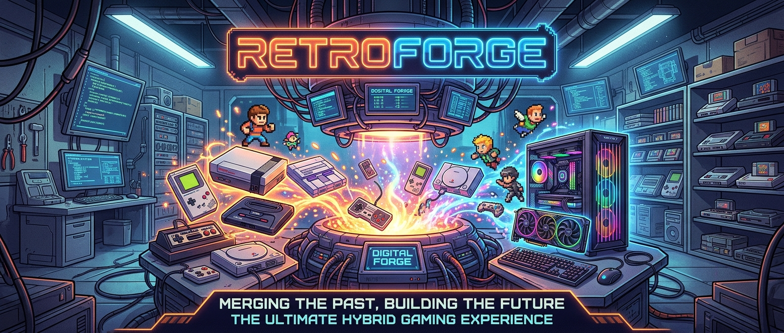

# RetroForge

A free Android frontend for retro games and PC games, all in one place.

Made by Darren Glancy, built with a lot of help from AI (Claude). Tested on a Samsung Galaxy S22 as it went.

**Status: beta (0.8.1).** It works well for most systems, but it's still being tested on more devices.
Feedback and bug reports are very welcome: [open an issue](../../issues).

## What it does

- **Plays games itself, nothing to set up.** Everything up to PlayStation, N64, PSP, Dreamcast and
  3DS, plus arcade (FinalBurn Neo, MAME, CPS), home computers (C64, Amiga, DOS, MSX, ZX Spectrum and
  more) and about 100 systems in all. Emulators download in the background.
- **Uses your collection as it is.** Point it at a RetroBat or ES-DE `roms` folder on the phone, an SD
  card or a shared folder on your PC, and it reads the titles, artwork, videos and manuals. It never
  changes your files.
- **PS3, PS4 and Switch, in RetroForge's own players.** Each is a separate free app that RetroForge opens
  your games in, with no menus of its own:
  [PS3 Player](https://github.com/RetroForgeFrontEnd/RetroForge-PS3-Player/releases) (built on RPCS3, with
  RPCN online sign-in and DLC from the game's page),
  [Switch Player](https://github.com/RetroForgeFrontEnd/RetroForge-Switch-Player/releases) (built on Eden,
  with Play Online rooms on your Wi-Fi) and
  [PS4 Player](https://github.com/RetroForgeFrontEnd/RetroForge-PS4-Player/releases) (built on shadPS4; an early
  preview, and most games are slow or don't start yet). You need your own
  games, keys and firmware from your own consoles.
- **Network drives built in.** Finds the PCs on your home network and lists their shared folders; no
  sign-in. Games stream straight from the PC, so even big disc games start at once.
- **In the game:** save states, fast-forward, cheats, screen shapes, CRT and LCD filters, upscaling
  (up to 10x for PSP), screenshots, an FPS counter, remappable buttons, keyboard and mouse for
  computers, dual-screen handhelds and Cardboard VR. Optional bezels in landscape from
  [The Bezel Project](https://github.com/thebezelproject), downloaded per system from their GitHub
  (not included in RetroForge; thanks to The Bezel Project for the artwork).
- **PC games, built in (new, early):** RetroForge's own PC player runs Windows games itself (Wine, FEX
  and DXVK, downloaded on first use), with Steam sign-in, Steam downloads, Steam Cloud saves, on-screen
  controls and LAN play. Plus streaming from your own PC (Moonlight/Sunshine built in) and Xbox Cloud Gaming.
- **Looks:** Bezel Project bezels round the game in landscape, and game lists as a list, a grid or a
  bookshelf of 3D game cases.
- **Play together:** netplay for up to 4 players on the same Wi-Fi, a virtual link cable for Game Boy
  trading and battles, Switch Play Online rooms, and tournaments for game nights.
- **Your library:** RetroAchievements, save states with pictures, playtime and a backlog, smart
  collections, a gaming passport, game notes and guides, kiosk mode with a child lock, and input profiles.
- **Saves everywhere:** save syncing through your PC's shared folder or a cloud app's folder, and a save
  importer for saves from other emulators.
- **Free games:** shareware, freeware and homebrew to download in one tap (Doom, Wolfenstein 3D, Commander
  Keen and new games for old consoles).
- **More ways to play:** RetroArch and 21 standalone emulators (Dolphin, NetherSX2, Azahar, Eden and
  more) through Obtainium, PC ports of games you own, and Windows games through GameNative,
  Winlator or DroidDeck.
- **ROM tools:** a ROM hack patcher and catalogue, soft patches, a ROM Manager (identify against No-Intro
  and Redump, rename, fix headers, duplicates, CHD/RVZ/zip compression, multi-disc playlists, all undoable)
  and PlayStation memory card tools.
- **Media:** your films with posters, Plex and other media servers without signing in, 3D films. A Music
  tab for songs on the phone or your PC, with Now Playing visuals and an equaliser, and internet radio
  from around the world. Your music keeps playing while you play.

The full feature list is in each [release](../../releases).

## What's coming

- More testing of PS3, PS4 and Switch on more phones and handhelds, and faster PS4 games.
- More move lists for Moves and turbo, and more of them checked in the games.

Ideas and requests are welcome: [open an issue](../../issues).

## Install

Download the APK from [Releases](../../releases) and open it on your Android device (Android 8 or
newer). Then open RetroForge and follow **Set up RetroForge**.

## Good to know

- **No games or BIOS files are included.** Use your own legally obtained games and BIOS dumps.
- GameCube, Wii and PS2 in the built-in player are new: they play on Vulkan (tested on a Galaxy S22),
  but have had far less testing than the other systems. The Dolphin and NetherSX2/ARMSX2 apps are
  offered too.
- No accounts, no ads, no tracking. See [SECURITY_AND_PRIVACY](docs/SECURITY_AND_PRIVACY.md).

## Building it yourself

See [BUILD_AND_INSTALL](docs/BUILD_AND_INSTALL.md). In short: Android Studio, JDK 17, then
`./gradlew :app:assembleFullDebug`.

## More

- [User guide](docs/USER_GUIDE.md) (the same guide as in the app)
- [Emulator compatibility](docs/EMULATOR_COMPATIBILITY.md)
- [Playing your PS4 games](docs/PS4_GAMES_GUIDE.md): dumping your own games and system files, as for shadPS4
- [Project status](docs/PROJECT_STATUS.md)
- [Third-party licences](docs/THIRD_PARTY_LICENCES.md): the emulators RetroForge downloads are their
  own projects under their own licences.

## Thanks

RetroForge stands on the work of a lot of people:

- **Windows games:** [GameNative](https://github.com/utkarshdalal/GameNative),
  [Winlator](https://github.com/brunodev85/winlator) and [DroidDeck](https://github.com/Droid-Deck/DroidDeck).
- **libretro and RetroArch:** the libretro API and every core author whose emulator the built-in player runs.
- **Standalone emulators:** Dolphin, NetherSX2, ARMSX2, Azahar, Eden, M64Plus FZ, melonDS, MAME4droid, SkyEmu,
  NooDS, EX Emulators, aPS3e, J2ME Loader and the rest.
- **PC ports and recomps:** Ship of Harkinian, 2 Ship 2 Harkinian, Starship, SpaghettiKart, Ghostship,
  Zelda64Recomp, Unleashed Recompiled, OpenGOAL, DevilutionX, OpenMW, OpenBOR and everyone who brought them to Android.
- **Collections:** RetroBat and ES-DE; [Obtainium](https://github.com/ImranR98/Obtainium) and the
  [Obtainium Emulation Pack](https://github.com/RJNY/Obtainium-Emulation-Pack);
  [canvas-es](https://github.com/Siddy212/canvas-es) by Siddy212.
- **Artwork and data:** SteamGridDB, ScreenScraper, libretro thumbnails, Romhacking.net and every hack author.
- **GPU drivers:** the Mesa Turnip developers, K11MCH1 and MrPurple.
- **The community:** the YouTube channels and sites in the app's Links tab.

## Support RetroForge

RetroForge is free, with every feature included, and always will be. If you're enjoying it, a coffee
helps pay for new features and bug fixes: **[buymeacoffee.com/darrenglant](https://buymeacoffee.com/darrenglant)**

## Licence

RetroForge is free software under the [GNU General Public License v3.0](LICENSE).
