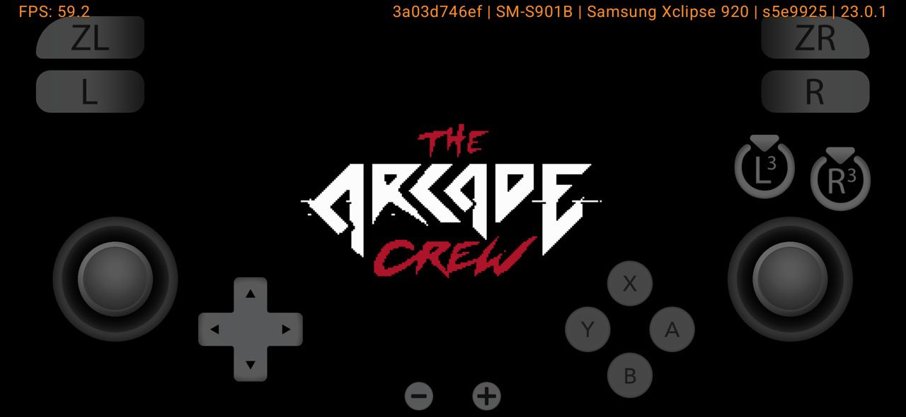
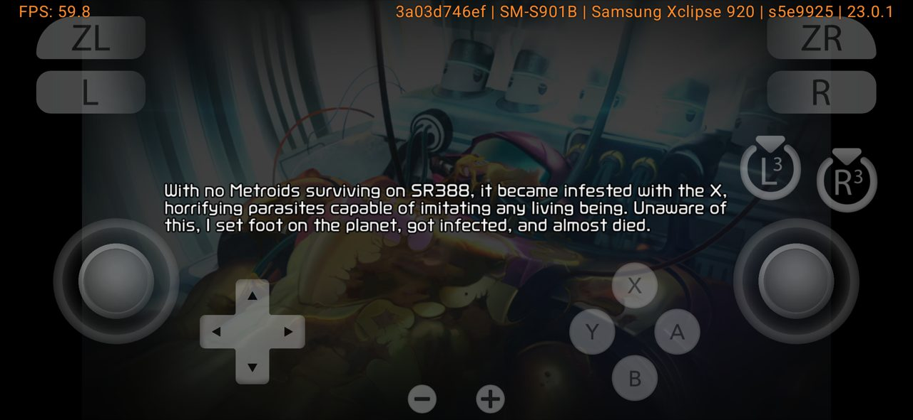
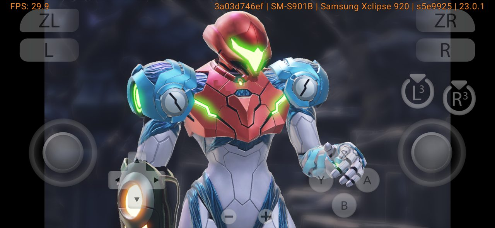
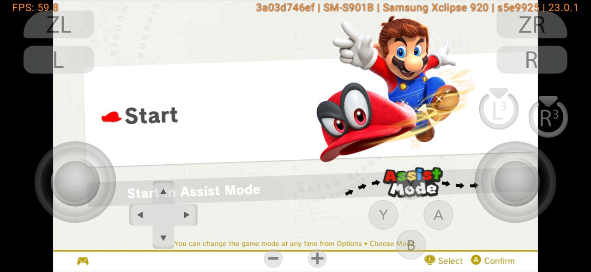
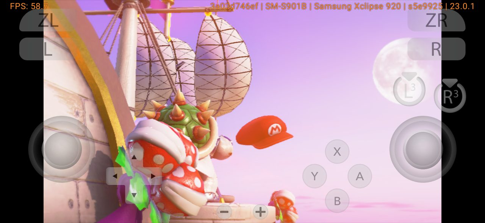
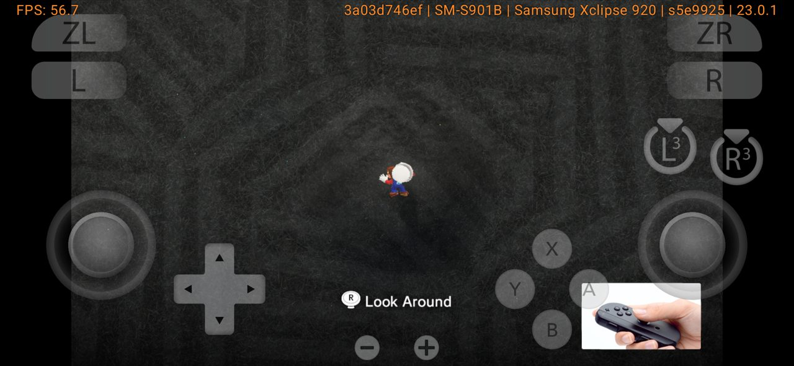
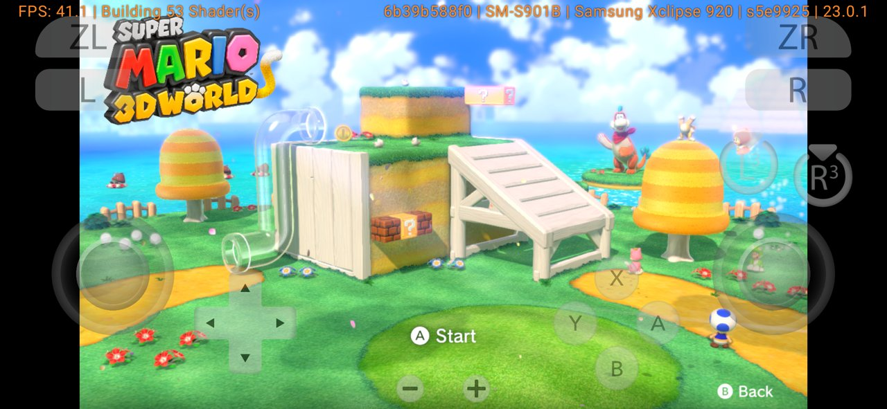
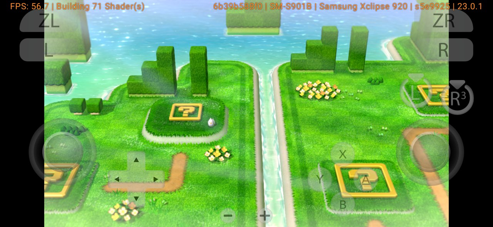
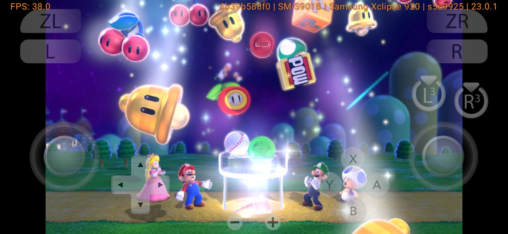
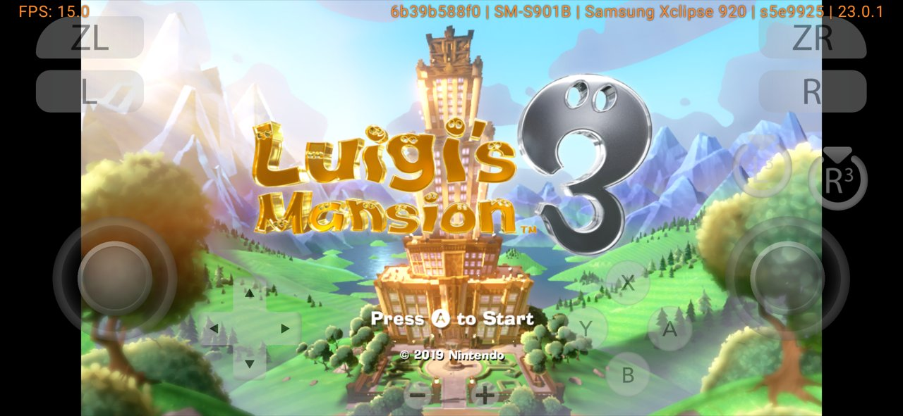

# Switch games on the RetroForge Switch Player: frame rates

Measured on 30 October 2026 with the RetroForge Switch Player 0.7.1 beta. The performance overlay was on during these tests and is off by default. Every game was on its first run, so each new scene first had to build its shaders. Frame rates rise once a scene's shaders are built and saved.

**Phone:** Samsung Galaxy S22 (Exynos 2200, Xclipse 920 graphics, 8 GB RAM), at 1× resolution with asynchronous shaders on (the player's defaults on 8 GB phones).

Xclipse is one of the weaker GPUs for Switch emulation. Snapdragon phones can use Turnip drivers, which usually run these games better.

| Game | Menus | Cutscenes | Playing | Verdict |
|---|---|---|---|---|
| Blazing Chrome | 60 | — | 59 | Full speed |
| Metroid Dread | 60 | 30 (as on the Switch) | not reached yet | Intro and menus at full speed |
| Super Mario Odyssey | 60 | 45–58 (choppy while shaders build) | 41–57 | Playable |
| Super Mario 3D World + Bowser's Fury | 60 | 38 while building shaders | 57 | Playable |
| Luigi's Mansion 3 | 12–15 | — | not reached | Too heavy for this phone |

## Screenshots

The overlay shows FPS at the top left and the phone and driver at the top right.

| | |
|---|---|
|  Blazing Chrome, 59 FPS |  Metroid Dread intro, 60 FPS |
|  Metroid Dread cutscene, 30 FPS |  Super Mario Odyssey menu, 60 FPS |
|  Super Mario Odyssey cutscene, 58 FPS |  Super Mario Odyssey playing, 57 FPS |
|  3D World title, 41 FPS while building shaders |  3D World playing, 57 FPS |
|  3D World opening, 38 FPS |  Luigi's Mansion 3 title, 15 FPS |

All games were dumped from the tester's own Switch. RetroForge and its players never include games, keys or firmware.
